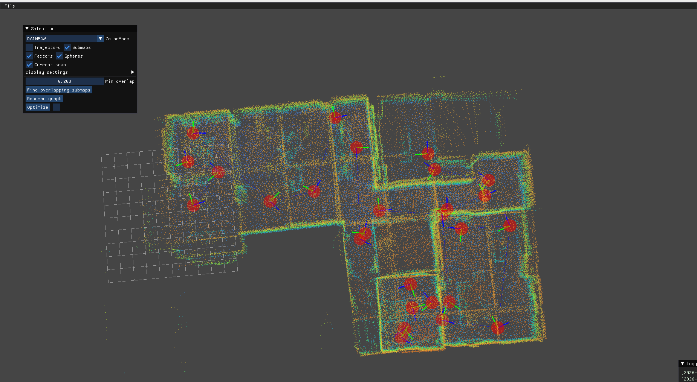
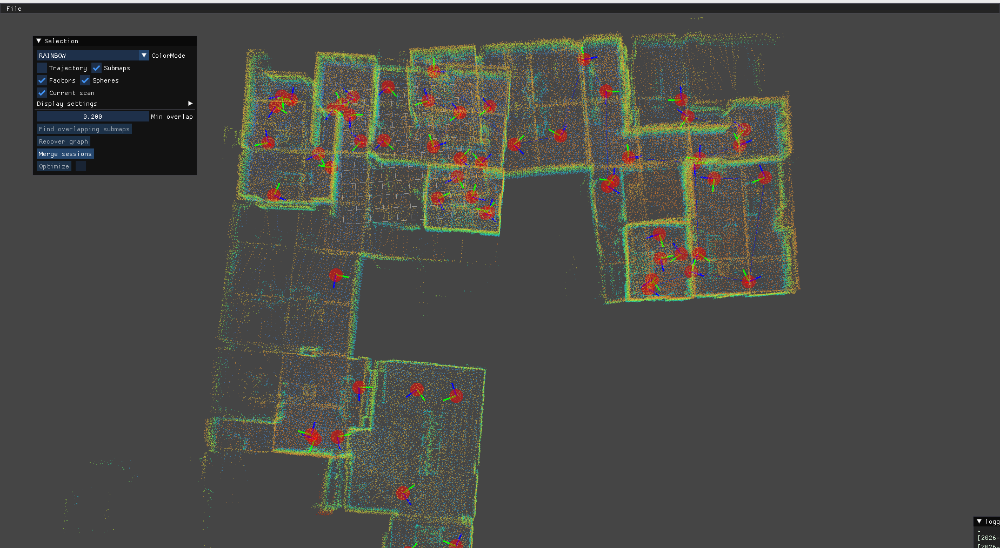
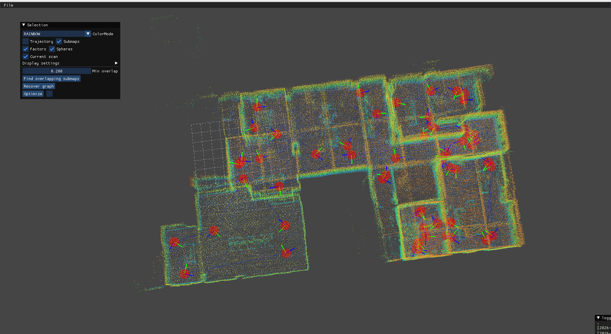

# SuperLIO + GLIM 多会话地图合并

工作流程：SuperLIO 在线建图与回环优化 → 导出优化关键帧和轨迹 → 转换为 GLIM dump → Offline Viewer 合并多会话地图。

## 当前功能

| 模块 | 当前实现 |
|---|---|
| 回环 | 默认 STD 检索 → 时间/距离筛选 → 多帧 FPFH + TEASER++ → GICP → iSAM2；普通 ICP 已移除，保留直接 GICP 对照模式 |
| 异步后端 | 配准、地图重建独立线程；检测任务有界排队，过载不删除关键帧和图节点 |
| 场景配置 | 室内、室外分别使用配准 YAML；传感器入口自动选择，可显式覆盖 |
| 重定位 | 局部 LIO 运动补偿累积 → TEASER++ / GICP → 变换最新 KF 状态并切换参考地图跟踪 |
| 时间 | 点云、位姿和 TF 保留传感器时间；默认回放不依赖 `/clock`，暂停和延迟回环不会推进或回退 TF 时间 |
| 可视化与诊断 | 强度伪彩色、3 像素点；地图独立体素滤波；接受/拒绝状态和最终理由按绿/红色突出显示 |
| 地图工具 | 优化关键帧导出、PCD/TUM 与 GLIM dump 双向转换 |

开发接口、参数和拒绝理由见 [SuperLIO 包说明](src/SuperLIO_SLAM/README.md)。详细设计和统计保留在 `docs/`。

## 工作区与构建

```text
src/SuperLIO_SLAM/   前端、STD、回环后端和重定位
src/glim/           GLIM
src/glim_ros2/      GLIM ROS 2 接口与 Offline Viewer
tools/              TEASER++ 构建和地图转换工具
```

以下命令用于本机 WSL Ubuntu 22.04 / ROS 2 Humble；换机器时调整路径。
GTSAM、GLIM 和可选 WSL DDS 设置见[依赖与环境配置](docs/workspace_setup.md)。

```bash
cd /home/ros/rosws/SuperLIO_GLIM_ROS2
source /opt/ros/humble/setup.bash
source /home/ros/rosws/livox_ros_ws/install/setup.bash

git submodule update --init --recursive
python3 tools/build_teaserpp.py --jobs 1
export LD_LIBRARY_PATH=/usr/local/lib:${LD_LIBRARY_PATH:-}

MAKEFLAGS=-j1 colcon build --symlink-install --executor sequential \
  --cmake-args -DGTSAM_DIR=/usr/local/lib/cmake/GTSAM \
  -DGTSAM_UNSTABLE_DIR=/usr/local/lib/cmake/GTSAM_UNSTABLE \
  -DSUPERLIO_WITH_TEASER=ON -DBUILD_TESTING=ON
source install/setup.bash
```

TEASER++ 安装在 `install/teaserpp`；只下载源码不能代替构建安装。
仅重编 SuperLIO 时，在 colcon 命令中增加 `--packages-select super_lio_slam`。
构建与运行 GLIM 必须使用同一套 GTSAM。

## 1. 分会话建图与录制

每个终端先加载环境，并使用一致的 DDS 配置：

```bash
cd /home/ros/rosws/SuperLIO_GLIM_ROS2
source /opt/ros/humble/setup.bash
source /home/ros/rosws/livox_ros_ws/install/setup.bash
source install/setup.bash
```

以 `/home/ros/dataset/unitree/firstpart` 和 `secondpart` 为例。
[Unitree 数据下载](https://drive.google.com/drive/folders/1hCyqttluoQbxpVullFv-Bdlff1dptu37?usp=drive_link)。

终端 A：

```bash
ros2 launch super_lio_slam unitree_slam.launch.py rviz:=true
```

终端 B，先启动录制，再开始回放：

```bash
mkdir -p /home/ros/dataset/unitree/superlio_results
ros2 bag record \
  -o /home/ros/dataset/unitree/superlio_results/firstpart_result \
  /lio_slam/keyframe /lio_slam/path
```

终端 C：

```bash
ros2 bag play /home/ros/dataset/unitree/firstpart --rate 0.5
```

回放结束后等待后端处理完毕，先停止录制，再停止 launch。
重启后将输入和结果目录中的 `firstpart` 换成 `secondpart`，处理第二段。
不要在同一个算法进程中从头重放或连续切换会话。

### 传感器入口与回环模式

| 数据 / 传感器 | 启动文件 | 默认配准配置 |
|---|---|---|
| Unitree L1 | `unitree_slam.launch.py` | `loop_indoor_teaser_gicp.yaml` |
| Robosense Airy | `robosense_airy.launch.py` | `loop_indoor_teaser_gicp.yaml` |
| VLP32 / UrbanNav | `vlp32.launch.py` | `loop_outdoor_teaser_gicp.yaml` |
| Livox MID-360 | `Livox_mid360.launch.py` | `loop_teaser_gicp.yaml` |

以下四种组合均支持；切换时重启 launch，无需重新编译：

```bash
# STD + TEASER++ + GICP（默认）
ros2 launch super_lio_slam unitree_slam.launch.py \
  loop_candidate_mode:=std loop_registration_mode:=std_teaser_gicp rviz:=true

# 距离检索 + TEASER++ + GICP
ros2 launch super_lio_slam unitree_slam.launch.py \
  loop_candidate_mode:=distance loop_registration_mode:=std_teaser_gicp rviz:=true

# STD + 直接 GICP
ros2 launch super_lio_slam unitree_slam.launch.py \
  loop_candidate_mode:=std loop_registration_mode:=std_gicp rviz:=true

# 距离检索 + 直接 GICP
ros2 launch super_lio_slam unitree_slam.launch.py \
  loop_candidate_mode:=distance loop_registration_mode:=std_gicp rviz:=true
```

关闭回环：增加 `enable_loop_backend:=false`，此时不发布用于下述导出的 SLAM 关键帧。
参数覆盖使用 `sensor_config`、`slam_config`、`registration_config`；阈值以所选 YAML 为准。
`loop_distance_teaser_gicp.yaml` 是可选实验配置，文件名不会自动切换候选方式。

## 2. 导出优化关键帧与轨迹

`export_superlio.py` 按时间戳关联关键帧和最后一条优化路径，输出 map 系点云与 TUM 位姿：

```bash
for part in firstpart secondpart; do
  python3 tools/export_superlio.py \
    --bag "/home/ros/dataset/unitree/superlio_results/${part}_result" \
    --out "/home/ros/dataset/unitree/superlio_results/${part}_export"
done
```

每个输出目录包含 `clouds/*.pcd`、`poses.txt` 和 `export_manifest.json`。
点云已经变换到 map 系，不要再次施加位姿；脚本不覆盖已有输出目录。

## 3. 转换为 GLIM dump

```bash
for part in firstpart secondpart; do
  python3 tools/lio2glim.py \
    --poses "/home/ros/dataset/unitree/superlio_results/${part}_export/poses.txt" \
    --clouds "/home/ros/dataset/unitree/superlio_results/${part}_export/clouds" \
    --out "/home/ros/dataset/unitree/superlio_results/${part}_dump" \
    --frames-per-submap 10 --voxel-size 0.2 --config src/glim/config
done
```

首次执行会编译 `tools/glim_graph_writer.cpp`，需要 GTSAM / gtsam_points 开发依赖。
完整 dump 应包含 `graph.txt`、`graph.bin`、`values.bin`、`config/` 及编号子图目录。

## 4. 合并多会话地图

```bash
export LD_LIBRARY_PATH=/usr/local/lib:${LD_LIBRARY_PATH:-}
ros2 run glim_ros offline_viewer \
  /home/ros/dataset/unitree/superlio_results/firstpart_dump
```

1. 加载第一段并启用优化；通过 **File → Open Additional Map** 加载第二段。
2. **Merge sessions** 粗配准，必要时手动调整 source，再执行 **Run fine registration**。
3. 确认重叠区域贴合，点击 **Create Factor**。
4. **Find overlapping submaps** 建立跨子图约束，再执行 **Optimize**。
5. 保存为新的合并 dump，保留两个输入目录。

| 第一段点云 | 第二段点云 | 合并结果 |
|---|---|---|
|  |  |  |

## 5. 从 GLIM 反向导出 PCD / TUM

```bash
python3 tools/glim2lio.py \
  --dump /home/ros/dataset/unitree/superlio_results/firstpart_dump \
  --out /home/ros/dataset/unitree/superlio_results/firstpart_reverse \
  --global-cloud --global-voxel-size 0.2
```

输出 `clouds/`（世界系子图点云）、`poses.txt`（子图 TUM）、`frames.txt`（完整帧轨迹）和 manifest；
`--global-cloud` 额外输出 `merged.pcd`。`--voxel-size` 控制子图降采样，
`--global-voxel-size` 控制全局点云降采样，设为 `0` 关闭对应滤波。
子图已合并原始扫描，不能从 dump 恢复逐扫描点云。

## 已有地图上的重定位

```bash
ros2 launch super_lio_slam relocation.launch.py \
  sensor_config:=/home/ros/rosws/SuperLIO_GLIM_ROS2/src/SuperLIO_SLAM/config/robosense_airy.yaml \
  map_path:=/absolute/path/to/reference_map.pcd rviz:=true
```

启动时需短暂静止进行 IMU 初始化，之后支持运动累积。
默认不修改参考地图；状态见 `/lio/relocation/status`，
初始位姿和配准参数使用独立的 `relocation.yaml`。
算法与坐标系说明见[包 README](src/SuperLIO_SLAM/README.md#重定位)。

## 常见问题

- 找不到 `teaserppConfig.cmake`：先运行 `tools/build_teaserpp.py`，确认依赖已安装。
- GTSAM / GLIM 符号缺失：核对实际加载库是否与构建一致，见[环境配置](docs/workspace_setup.md)。
- 导出缺少关键帧：检查录制是否覆盖整段运行，以及最终路径是否已发布完成。
- 缺少点云 `time` 字段：零偏移不能替代逐点运动补偿，需适配数据字段。
- 地图或坐标轴不显示：检查显示项状态、TF 链和消息时间，见[时间策略](docs/sensor_time_playback.md)。

`src/SuperLIO_SLAM`、`src/glim`、`src/glim_ros2` 和 `tools` 共同组成工作区；
第三方子模块说明见 [third_party/README](src/SuperLIO_SLAM/third_party/README.md)。
